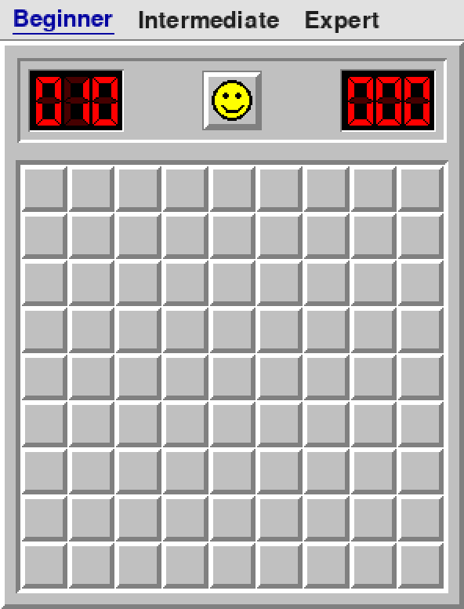

# Minesweeper

A classic-style Minesweeper in Python + pygame. Free downloads for Windows and Mac,
no Python needed. **[Website and downloads →](https://damg22.github.io/Minesweeper/)**



## Download and play (no Python needed)

Grab the latest build from the **[Releases page](https://github.com/damg22/Minesweeper/releases/latest)**:

| System | File |
|---|---|
| Windows | `Minesweeper-windows.exe` |
| Mac with Apple Silicon (M1 or newer) | `Minesweeper-macos-apple-silicon.zip` |
| Intel Mac | `Minesweeper-macos-intel.zip` |

The apps aren't code-signed, so the first launch shows a warning:

- **Windows:** on the "Windows protected your PC" screen, click **More info → Run anyway**.
- **Mac:** unzip, then right-click `Minesweeper.app` → **Open** → **Open**. If macOS still
  blocks it, go to **System Settings → Privacy & Security** and click **Open Anyway**.

## Run from source

```bash
python3 -m venv .venv
.venv/bin/pip install -r requirements.txt
```

Then:

```bash
.venv/bin/python main.py                       # beginner 9x9, 10 mines
.venv/bin/python main.py -d expert             # beginner | intermediate | expert
.venv/bin/python main.py --custom 20 24 80     # rows cols mines
.venv/bin/python main.py --preview             # sample board showing every tile type
```

## Controls

| Input                                   | Action                         |
|-----------------------------------------|--------------------------------|
| Left click                              | reveal                         |
| Right click / Ctrl+click / Cmd+click    | flag / question mark           |
| Left+Right, middle click, Shift+click   | chord                          |
| Smiley, `F2`, `N`                       | new game                       |
| `1` / `2` / `3` or the menu bar         | beginner / intermediate / expert |
| `Esc`                                   | quit                           |

## Layout

```
main.py                  entry point / CLI flags
minesweeper/
  game.py                YOUR CODE: Cell, CellState, GameStatus, Game (stubs with TODOs)
  ui.py                  window, input, rendering (reads Game state, calls Game actions)
  graphics.py            tile / mine / flag / LED / smiley drawing
  settings.py            sizes, colours, difficulty presets
  preview.py             hard-coded demo board used by --preview
```

## What the UI expects from `Game`

- `Game(rows, cols, mines)`
- attributes: `rows`, `cols`, `mines`, `status` (a `GameStatus`)
- `cell(r, c)` returns a `Cell` with `is_mine`, `adjacent_mines`, `state`, `exploded`
- `flags_remaining()` returns the number for the left counter
- `reveal(r, c)`, `toggle_flag(r, c)`, `chord(r, c)` change the state

The timer starts when `status` becomes `PLAYING` and stops on `WON` or `LOST`.
On `LOST` the UI shows all mines and crosses out wrong flags. On `WON` it shows
every mine as a flag. Your logic only needs to set the state.

## Publishing a new release

GitHub Actions (`.github/workflows/build.yml`) builds the Windows and Mac apps on every
push; the files show up under each run's **Artifacts** on the Actions tab.

To publish a release that anyone can download, push a version tag:

```bash
git tag v1.0.0
git push origin v1.0.0
```

About 5 minutes later the Releases page has the three downloads attached.
